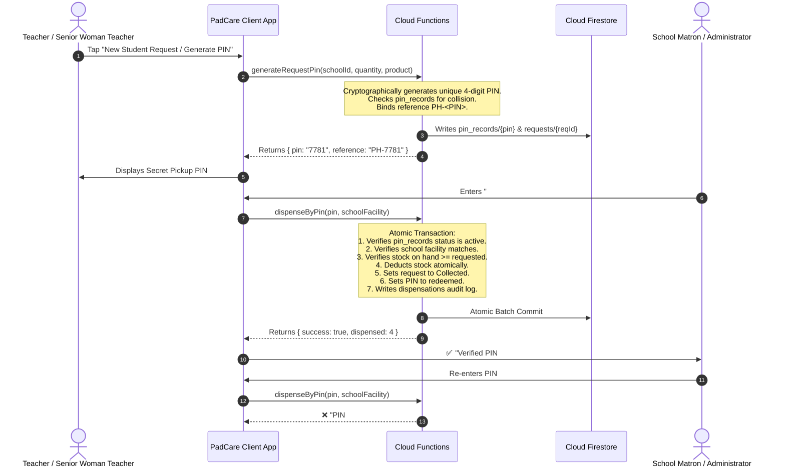

# PadCare – Firebase Backend Architecture & Integration Guide

This document details the production-ready Firebase backend powering the **PadCare** menstrual health and confidential sanitary pad distribution network across Arua City, Uganda.

---

## 1. High-Level Architecture & Transaction Flow



---

## 2. Role-Based Access Control (RBAC) Matrix

| User Role | Identifier | Responsibilities & Access Permissions | Isolation Scope |
| :--- | :--- | :--- | :--- |
| **A. Teacher** | `teacher` | Creates confidential pad requests for students, views previous requests, receives generated pickup PINs. | Strict to assigned `schoolId`. |
| **B. School Matron / Admin** | `school_admin` | Reviews school inbox, verifies pickup PINs, dispenses stock atomically, requests central hub restock. | Strict to assigned `schoolId`. Cannot access other schools' records. |
| **C. Sponsor / Donor** | `sponsor` | Views funding targets, funds dignity kit campaigns, views contribution history & impact reports. | Public campaign metrics; private donation history. |
| **D. Platform Super Admin** | `super_admin` | Global platform administration: registers schools, approves/suspends facilities, assigns matrons, reviews audit logs. | Platform-wide global access. |
| **E. Parent / Community** | `parent` | Emergency sanitary pad requests, menstrual cycle tracking, support point navigation. | Confidential & anonymous. |

---

## 3. Firestore Database Collections & Schema Reference

### 1. `users/{uid}`
- `uid`: `string` (Firebase Auth UID)
- `email`: `string`
- `fullName`: `string`
- `phoneNumber`: `string` (`+256...`)
- `photoUrl`: `string` (Firebase Storage URL)
- `role`: `string` (`'teacher'` | `'school_admin'` | `'sponsor'` | `'super_admin'` | `'parent'`)
- `schoolId`: `string` (e.g. `'st-marys-secondary'`)
- `schoolName`: `string` (e.g. `'St. Mary\'s Secondary'`)
- `accountStatus`: `string` (`'active'` | `'pending_approval'` | `'suspended'`)
- `createdAt`: `timestamp`
- `lastLoginAt`: `timestamp`
- `fcmToken`: `string` (Device push token)
- `notificationPreferences`: `map` (`{ requests: true, inventory: true, announcements: true }`)

### 2. `schools/{schoolId}`
- `schoolId`: `string` (slug identifier, e.g. `'st-marys-secondary'`)
- `name`: `string`
- `registrationNumber`: `string`
- `district`: `string` (`'Arua'`)
- `subCounty`: `string` (`'Arua Hill'`)
- `contactPhone`: `string`
- `contactEmail`: `string`
- `logoUrl`: `string`
- `status`: `string` (`'active'` | `'pending'` | `'suspended'`)
- `assignedStaffUids`: `array of strings`
- `createdAt`: `timestamp`

### 3. `inventory/{schoolId_productId}`
- `id`: `string` (e.g. `'st-marys-secondary_disposable-pads'`)
- `schoolId`: `string`
- `productId`: `string` (`'disposable-pads'` | `'reusable-kits'`)
- `productName`: `string`
- `availableQuantity`: `int`
- `reservedQuantity`: `int`
- `totalReceived`: `int`
- `totalDistributed`: `int`
- `unit`: `string` (`'packs'` | `'kits'`)
- `lowStockThreshold`: `int`
- `lastUpdated`: `timestamp`

### 4. `requests/{requestId}`
- `requestId`: `string` (e.g. `'REQ-7781'`)
- `reference`: `string` (`'PH-7781'`)
- `teacherUid`: `string`
- `teacherName`: `string`
- `schoolId`: `string`
- `school`: `string`
- `productId`: `string`
- `product`: `string`
- `quantity`: `int`
- `pickupPin`: `string` (`'7781'`)
- `status`: `string` (`'Pending'` | `'Approved'` | `'Ready for collection'` | `'Collected'` | `'Cancelled'`)
- `createdAt`: `timestamp`
- `approvedAt`: `timestamp`
- `collectedAt`: `timestamp`
- `collectedBy`: `string`

### 5. `pin_records/{pin}`
- `pin`: `string` (`'7781'`)
- `requestId`: `string`
- `reference`: `string`
- `schoolId`: `string`
- `productId`: `string`
- `quantity`: `int`
- `status`: `string` (`'active'` | `'redeemed'` | `'expired'` | `'revoked'`)
- `failedAttempts`: `int` (locks at 5 attempts)
- `expiresAt`: `timestamp`
- `createdAt`: `timestamp`
- `redeemedAt`: `timestamp`

### 6. `dispensations/{dispensationId}`
- `dispensationId`: `string` (`'DIST-REQ-7781'`)
- `requestId`: `string`
- `reference`: `string`
- `pickupPin`: `string`
- `school`: `string`
- `productId`: `string`
- `quantity`: `int`
- `dispensedBy`: `string`
- `dispensedAt`: `timestamp`
- `status`: `string` (`'completed'`)

### 7. `donations/{donationId}` & `campaigns/{campaignId}`
- `donationId`: `string`
- `sponsorUid`: `string`
- `donorName`: `string`
- `amount`: `int` (in UGX)
- `currency`: `string` (`'UGX'`)
- `kitsFunded`: `int`
- `school`: `string`
- `paymentMethod`: `string` (`'MoMo'` | `'Airtel'` | `'Card'`)
- `status`: `string` (`'completed'`)
- `reference`: `string`
- `timestamp`: `timestamp`

### 8. `audit_logs/{logId}`
- `logId`: `string`
- `action`: `string` (`'DISPENSE_PIN'` | `'STOCK_RECEIVED'` | `'USER_ROLE_CHANGED'`)
- `performedBy`: `string` (UID)
- `schoolId`: `string`
- `details`: `map`
- `timestamp`: `timestamp`

---

## 4. Firebase Emulator Suite Configuration

For local development and automated offline testing, the emulator suite is configured in `firebase.json`:

```bash
# Start all emulators locally
firebase emulators:start
```

| Emulator | Port | Usage |
| :--- | :--- | :--- |
| **Authentication** | `9099` | Local account sign-in & JWT generation |
| **Cloud Firestore** | `8085` | Isolated local document database |
| **Cloud Functions** | `5001` | Local triggers and callable API execution |
| **Cloud Storage** | `9199` | Local profile photo & document storage |
| **Emulator UI** | `4000` | Web inspector dashboard at `http://localhost:4000` |

---

## 5. Production Deployment Instructions

1. **Deploy Security Rules & Indexes**:
   ```bash
   firebase deploy --only firestore:rules,firestore:indexes,storage
   ```
2. **Deploy Cloud Functions**:
   ```bash
   cd functions && npm install && cd ..
   firebase deploy --only functions
   ```
3. **Build & Deploy Web App**:
   ```bash
   flutter build web --release --base-href /PadCare/
   firebase deploy --only hosting
   ```
